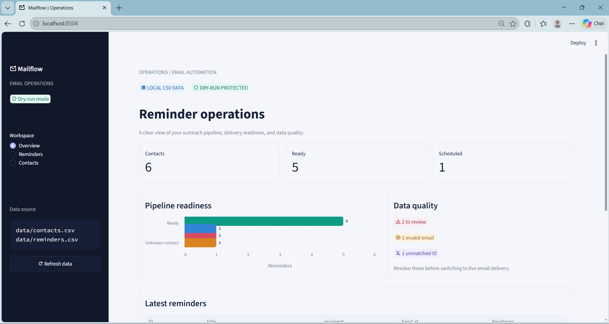
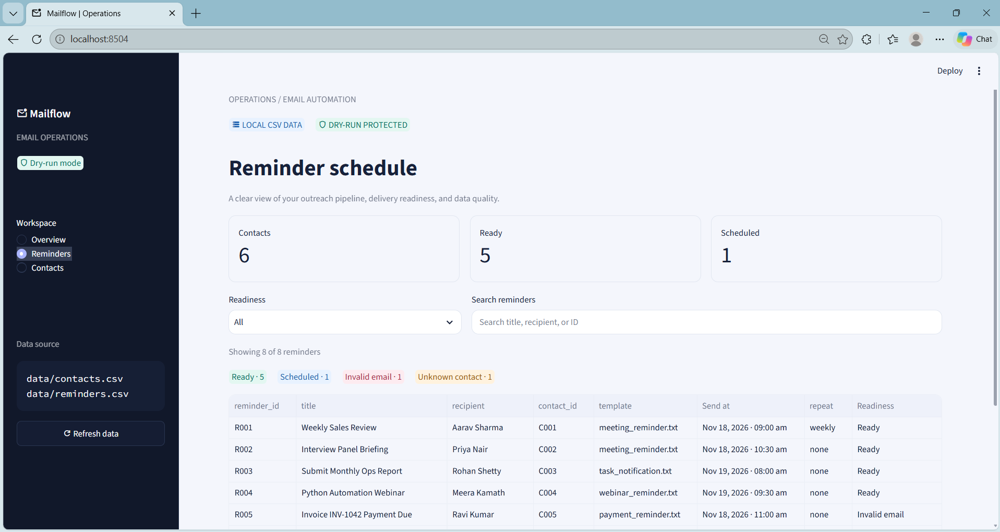
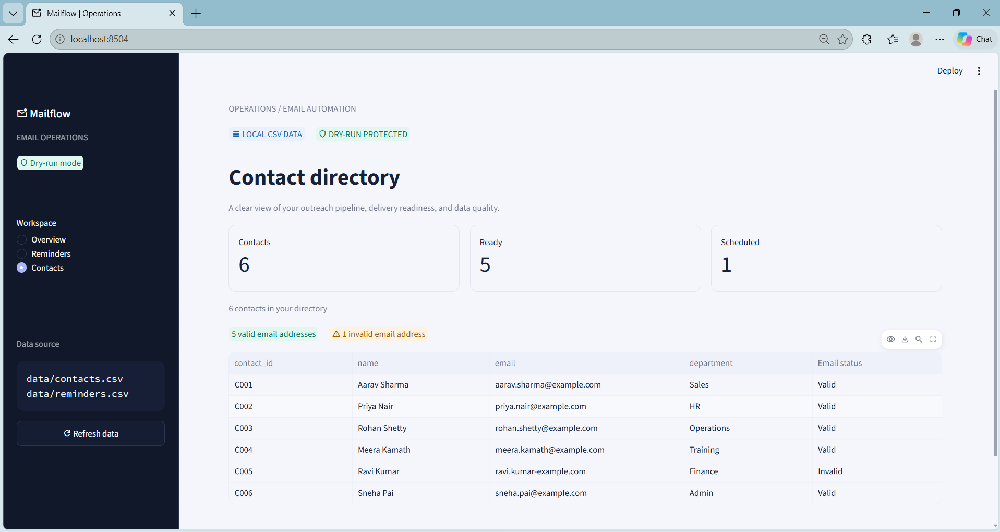
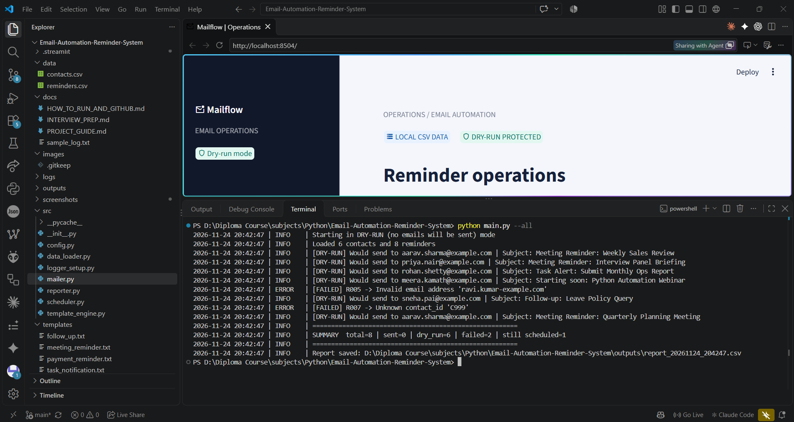
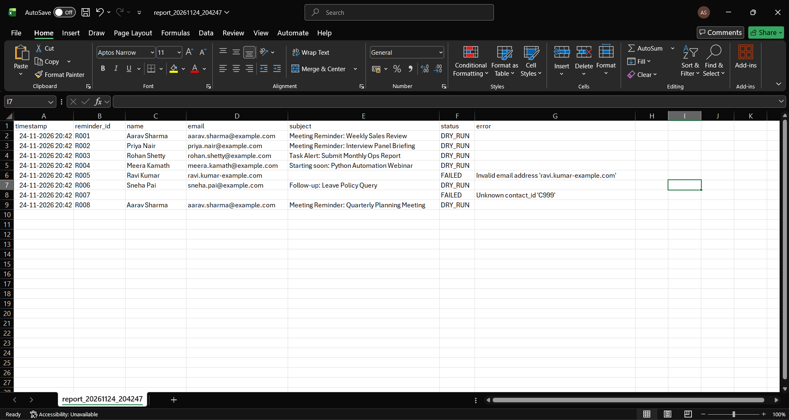
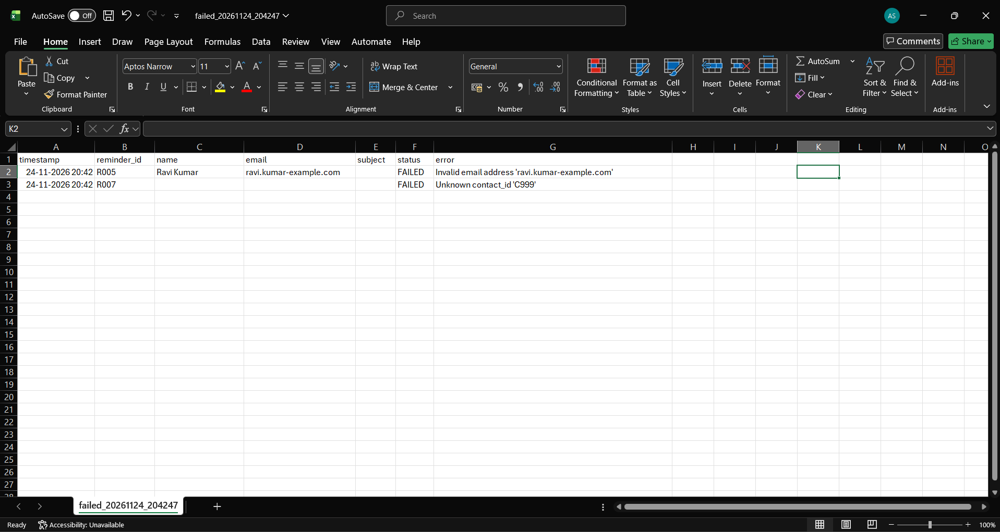
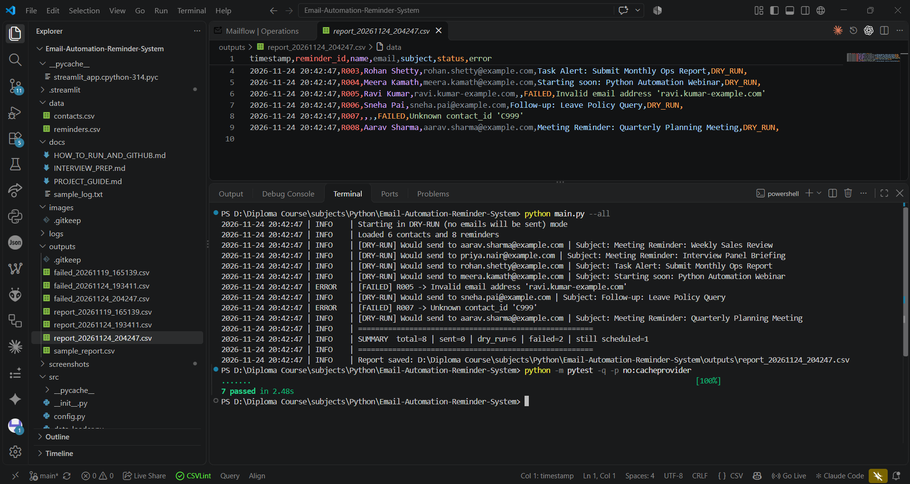
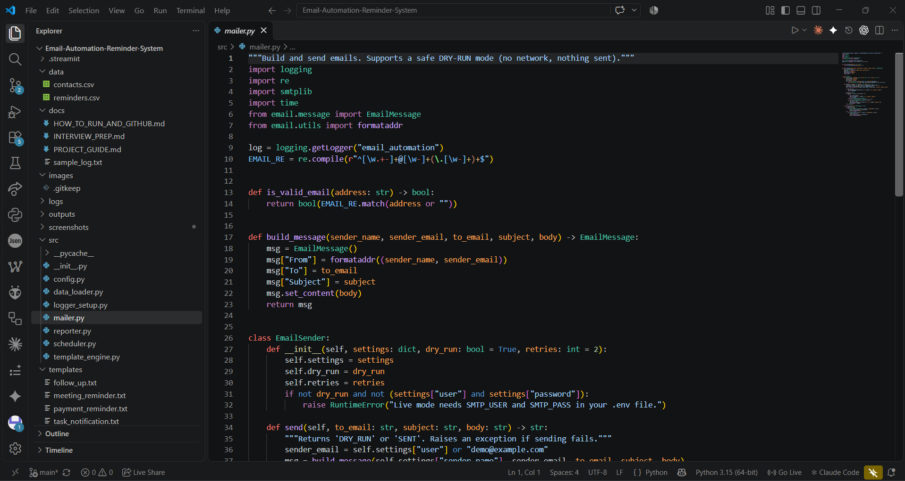
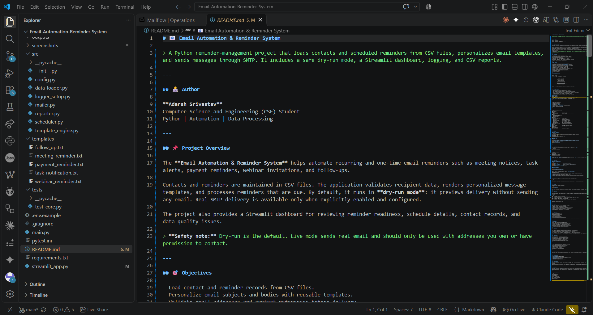

# 📧 Email Automation & Reminder System

> A Python reminder-management project that loads contacts and scheduled reminders from CSV files, personalizes email templates, and sends messages through SMTP. It includes a safe dry-run mode, a Streamlit dashboard, logging, and CSV reports.

---

## 👨‍💻 Author

**Adarsh Srivastav**<br>
Computer Science and Engineering (CSE) Student<br>
Python | Automation | Data Processing

---

## 📌 Project Overview

The **Email Automation & Reminder System** helps automate recurring and one-time email reminders such as meeting notices, task alerts, payment reminders, webinar invitations, and follow-ups.

Contacts and reminders are maintained in CSV files. The application validates recipient data, renders personalized message templates, and processes reminders that are due. By default, it runs in **dry-run mode**: it previews delivery without sending any email. Real SMTP delivery is available only when explicitly enabled and configured.

The project also provides a Streamlit dashboard for reviewing reminder readiness, schedule details, contact records, and data-quality issues.

> **Safety note:** Dry-run is the default. Live mode sends real email and should only be used with addresses you own or have permission to contact.

---

## 🎯 Objectives

- Load contact and reminder records from CSV files.
- Personalize email subjects and bodies with reusable templates.
- Validate email addresses and contact references before delivery.
- Process due or recurring reminders.
- Keep one bad record from stopping the rest of a batch.
- Support safe previews and optional SMTP delivery.
- Provide logs, CSV reports, and a dashboard for operational visibility.
- Keep SMTP credentials outside the source code.

---

## ✨ Key Features

- CSV-based contact and reminder management using Pandas.
- Five reusable text templates with `{{placeholder}}` substitution.
- **Dry-run by default**; real delivery requires the `--live` option.
- SMTP delivery with configurable host, port, sender, and credentials.
- Input validation and per-reminder error reporting.
- One-time and daily/weekly recurring reminders.
- Command-line execution and periodic scheduler mode.
- Streamlit dashboard with Overview, Reminders, and Contacts views.
- Reminder search and readiness filters in the dashboard.
- Dashboard preview action always uses dry-run mode.
- Timestamped run reports and failed-reminder reports.
- Console and file logging.
- Unit tests with pytest.

---

## 📸 Screenshots

| Dashboard overview | Reminder schedule |
|---|---|
|  |  |

| Reminder filter | Contact directory |
|---|---|
|  |  |

| Safe dry-run | Full run report |
|---|---|
|  |  |

| Failed-only report | Test results |
|---|---|
|  |  |

| Project structure | README in VS Code |
|---|---|
|  |  |

---

## 🏗️ System Architecture

```text
contacts.csv ─┐
              ├──► CSV loading and validation
reminders.csv ┘             │
                             ▼
                   Reminder scheduling
                             │
                  Contact + email checks
                             │
                    Template rendering
                             │
                 ┌───────────┴───────────┐
                 ▼                       ▼
          Dry-run preview          SMTP delivery
                 └───────────┬───────────┘
                             ▼
                   Logs and CSV reports

CSV data ──► Streamlit dashboard (read-only overview and dry-run preview)
```

---

## 🔄 Working Principle

1. Read contacts and reminders from the configured CSV files.
2. Select reminders that are due, or all reminders when `--all` is used.
3. Check that the reminder date, contact ID, and recipient email are valid.
4. Load the selected template and fill its placeholders with reminder and contact data.
5. Preview the message in dry-run mode or deliver it through SMTP in live mode.
6. Record successful and failed outcomes in logs and CSV reports.
7. Advance recurring reminders to their next daily or weekly occurrence.

### Delivery Modes

| Mode | Behavior |
|---|---|
| Dry-run (default) | Logs which messages would be sent; does not connect to SMTP. |
| Live (`--live`) | Sends actual email through the configured SMTP server. |

---

## 💻 Software & Tools

- **Language:** Python 3.10+
- **Data processing:** Pandas
- **Dashboard:** Streamlit
- **Email:** `smtplib`, `email.message`
- **Scheduling:** `schedule`
- **Configuration:** `python-dotenv`, environment variables
- **Testing:** pytest
- **Version control:** Git and GitHub

---

## 📁 Project Structure

```text
Email-Automation-Reminder-System/
├── .streamlit/
│   └── config.toml             # Dashboard theme
├── data/
│   ├── contacts.csv            # Contact records
│   └── reminders.csv           # Reminder schedule and template names
├── docs/
│   ├── HOW_TO_RUN_AND_GITHUB.md
│   ├── INTERVIEW_PREP.md
│   ├── PROJECT_GUIDE.md
│   └── sample_log.txt
├── outputs/
│   └── sample_report.csv       # Example report
├── screenshots/                # Project, dashboard, report, and test captures
├── src/
│   ├── config.py               # Paths and SMTP settings
│   ├── data_loader.py          # CSV loading and validation
│   ├── logger_setup.py         # Console and file logging
│   ├── mailer.py               # Dry-run and SMTP sender
│   ├── reporter.py             # CSV reports and summaries
│   ├── scheduler.py            # Due and recurring reminders
│   └── template_engine.py      # Template loading and rendering
├── templates/                  # Email subject/body templates
├── tests/
│   └── test_core.py
├── .env.example                # Safe SMTP configuration template
├── .gitignore
├── main.py                     # CLI entry point
├── requirements.txt
└── streamlit_app.py            # Dashboard entry point
```

---

## 🛠️ Setup

### Windows PowerShell

```powershell
git clone https://github.com/adarshsrivastav23905/Email-Automation-Remainder-System.git
Set-Location Email-Automation-Remainder-System
python -m venv .venv
.\.venv\Scripts\Activate.ps1
python -m pip install -r requirements.txt
```

### macOS / Linux

```bash
git clone https://github.com/adarshsrivastav23905/Email-Automation-Remainder-System.git
cd Email-Automation-Remainder-System
python3 -m venv .venv
source .venv/bin/activate
python -m pip install -r requirements.txt
```

---

## 🔐 SMTP Configuration

SMTP credentials are only needed for live delivery. Copy the example file to `.env`:

```powershell
Copy-Item .env.example .env
```

Then update `.env` with your own settings:

```dotenv
SMTP_HOST=smtp.gmail.com
SMTP_PORT=465
SMTP_USER=your_email@gmail.com
SMTP_PASS=your_app_password
SENDER_NAME=Automation Bot
```

For Gmail, use an App Password if required by your account. Never commit `.env` or share SMTP credentials. The repository ignores `.env`; `.env.example` contains placeholders only.

---

## ▶️ How to Run

### Command-line application

```bash
python main.py --all                 # dry-run every reminder
python main.py                       # dry-run reminders due now
python main.py --schedule            # check periodically (30-second default)
python main.py --schedule --interval 10
python -m pytest -q                  # run tests
```

### Streamlit dashboard

```bash
python -m streamlit run streamlit_app.py
```

Open the local URL printed by Streamlit, typically `http://localhost:8501`.

The dashboard provides:

- **Overview:** counts for contacts, ready reminders, scheduled reminders, and data-quality issues.
- **Reminders:** searchable schedule with a readiness filter.
- **Contacts:** contact directory and email validation status.
- **Preview ready reminders:** safe dry-run preview; this dashboard action never enables live delivery.

### Optional live email delivery

Only after configuring valid SMTP credentials and confirming the recipient data:

```bash
python main.py --live --all
```

This sends real emails. Use only consent-based addresses that you control or are authorized to contact.

---

## 🧪 Testing

Run the unit tests from the project root:

```bash
python -m pytest -q
```

Tests cover core project behavior such as CSV loading, template rendering, email validation, and reminder processing.

---

## 📊 Sample Run

With the included sample CSV files, `python main.py --all` runs in dry-run mode. The sample data intentionally contains an invalid email address and an unknown contact ID, so those records are reported as failures while the other valid records are previewed.

```text
INFO    | Starting in DRY-RUN (no emails will be sent) mode
INFO    | Loaded 6 contacts and 8 reminders
INFO    | [DRY-RUN] Would send to ... | Subject: Meeting Reminder: Weekly Sales Review
ERROR   | [FAILED] R005 -> Invalid email address 'ravi.kumar-example.com'
ERROR   | [FAILED] R007 -> Unknown contact_id 'C999'
INFO    | SUMMARY  total=8 | sent=0 | dry_run=6 | failed=2 | still scheduled=1
```

The recurring reminder is advanced to its next occurrence, which remains scheduled. Results are saved under `outputs/`; runtime reports and logs are ignored by Git.

---

## 📈 Results

The project demonstrates an end-to-end reminder workflow:

- Loads and validates contact and reminder data.
- Selects due reminders or processes all records for a dry-run demo.
- Generates personalized subjects and message bodies.
- Separates successful previews/deliveries from invalid records.
- Produces an execution summary and CSV report.
- Shows readiness and contact quality in the dashboard.

---

## 🌐 Applications

The workflow can be adapted for:

- Meeting and interview reminders
- Task and report deadlines
- Payment due notifications
- Webinar and event invitations
- Follow-up and onboarding messages
- Administrative and educational notifications

Use the system only for recipients who have consented or are otherwise authorized to receive the messages.

---

## ✅ Advantages

- Starts safely without requiring SMTP credentials.
- Uses simple CSV inputs that are easy to inspect and edit.
- Keeps templates separate from scheduling and delivery logic.
- Continues processing after an individual reminder fails.
- Includes both a CLI workflow and a visual dashboard.
- Keeps runtime reports and credentials out of version control.
- Provides tests and sample data for local evaluation.

---

## ⚠️ Limitations

- CSV files are the data store; there is no database or multi-user access control.
- The scheduler and reminder completion state are in memory for the current process.
- Live delivery depends on SMTP provider availability and valid credentials.
- The sample contacts include intentionally invalid data for demonstrating validation.
- The dashboard is local and does not provide authentication or remote hosting configuration.
- Delivery is not a substitute for consent management, unsubscribe processing, or production email compliance controls.

---

## 🚀 Future Scope

- Persistent database storage and reminder history.
- User authentication and role-based dashboard access.
- Reminder creation and editing through the dashboard.
- Improved recurring schedules and time-zone handling.
- Delivery status tracking and retry monitoring.
- Consent, unsubscribe, and suppression-list management.
- Email-provider integrations and deployment guidance.

---

## 🎓 Skills Demonstrated

- Python application structure and command-line interfaces.
- CSV processing and data validation with Pandas.
- Email composition, SMTP, and safe dry-run design.
- Template-based personalization.
- Scheduling, logging, and report generation.
- Streamlit dashboard development.
- Environment-based secret configuration.
- Unit testing and Git/GitHub workflow.

---

## 💼 Industry Relevance

The project models common automation tasks across HR, sales, finance, operations, and education. It demonstrates how data ingestion, validation, templating, scheduling, delivery, and reporting can be combined into a small maintainable workflow.

---

## 📚 Documentation

- [Project guide](docs/PROJECT_GUIDE.md)
- [How to run and GitHub guide](docs/HOW_TO_RUN_AND_GITHUB.md)
- [Interview preparation](docs/INTERVIEW_PREP.md)
- [Sample log](docs/sample_log.txt)
- [Sample report](outputs/sample_report.csv)

---

## 🔬 Project Status

**Functional educational project** with a CLI, dry-run and SMTP modes, recurring scheduling, CSV reports, tests, and a Streamlit dashboard.

The included dataset is illustrative. Review and replace it with appropriate, consent-based data before any live sending.

---

## ⭐ Conclusion

The **Email Automation & Reminder System** demonstrates a practical path from CSV-based scheduling to personalized email generation, safe preview, optional SMTP delivery, and operational reporting. Its dry-run default makes it suitable for learning and local demonstrations, while the modular design provides a base for future persistence, consent controls, and deployment.

---

## ⭐ Project Highlights

```text
Python 3.10+
Pandas CSV Processing
5 Email Templates
Dry-run by Default
Optional SMTP Delivery
Daily / Weekly Recurrence
CLI + Streamlit Dashboard
Logging + CSV Reports
pytest Test Suite
```

**Project status: ✅ Functional educational prototype | 🛡️ Dry-run by default | 📊 Dashboard included**
